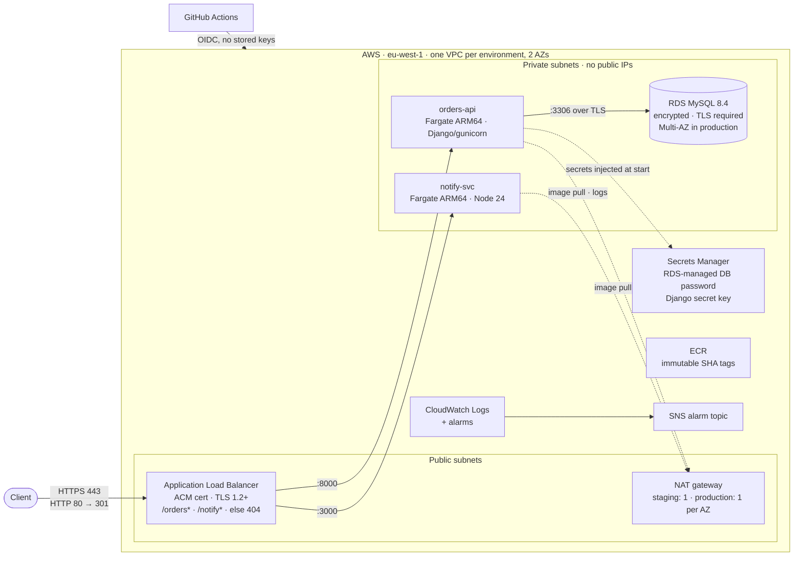
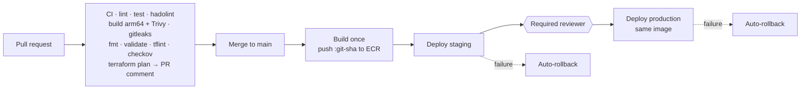

# EA Foods — DevOps Take-Home

[](https://github.com/Emmacontrol/ea-foods-devops/actions/workflows/ci.yml)

Two small services, `orders-api` (Django + MySQL) and `notify-svc` (Node.js), run on **AWS ECS Fargate** in private subnets behind an **HTTPS Application Load Balancer**, with a private **RDS MySQL** database. **Terraform** provisions the infrastructure, with staging and production built from one codebase. **GitHub Actions** ships it: images are built once, promoted from staging to production behind an approval, and rolled back automatically or with one click.

- **Run it locally:** `make up` ([details](#run-locally))
- **Terraform plan output** (against a real AWS account, nothing applied): [`docs/plans/`](docs/plans)
- **Operations:** [`RUNBOOK.md`](RUNBOOK.md) covers rolling back a bad release, point-in-time database restore, and the alarm reference.

## Contents
[Repository layout](#repository-layout) · [Run locally](#run-locally) · [Architecture](#architecture) · [Deploy](#deploy) · [CI/CD](#cicd) · [Rollback](#rollback) · [Security](#security) · [Monitoring and reliability](#monitoring-and-reliability) · [Trade-offs](#trade-offs) · [Cost](#estimated-monthly-aws-cost) · [Next steps](#what-id-add-for-production--with-more-time)

## Repository layout

```
apps/
  orders-api/        Django + MySQL: GET /health, GET /orders (Dockerfile, tests)
  notify-svc/        Node.js, zero dependencies: GET /health, GET /notify, one JSON log line per request
infra/
  bootstrap/         One-time, account level: state bucket, ECR repos, GitHub OIDC roles
  modules/           network · alb · ecs-service · rds · monitoring
  stack/             One complete environment, composed from the modules
  envs/staging/      Staging settings (cost-optimised)
  envs/production/   Production settings (availability-optimised)
.github/workflows/   ci.yml (PRs) · deploy.yml (main) · _deploy.yml (shared) · rollback.yml (manual)
scripts/             deploy.sh · rollback.sh · run-migrations.sh · smoke-test.sh
docs/plans/          terraform plan output for bootstrap, staging and production
RUNBOOK.md           Release rollback, point-in-time restore, alarm reference
```

## Run locally

Requirements: Docker with Compose v2.

```bash
make up                       # build images, start MySQL, run migrations (one-off job), start both services
curl -i localhost:8000/orders # 3 seeded orders read from MySQL; X-App-Version header
curl -i localhost:3000/notify # {"status":"sent",...}, and one JSON log line per request
curl localhost:8000/health    # {"status": "ok", "service": "orders-api", "version": "local"}
make logs                     # tail logs
make down                     # stop and delete the local database volume
```

| Command | What it runs |
|---|---|
| `make test` | pytest (orders-api, SQLite) and `node:test` (notify-svc) |
| `make lint` | pre-commit: ruff, hadolint, terraform fmt/tflint, gitleaks |
| `make tf-validate` | `terraform fmt -check` plus `validate` for both environments |
| `make security-scan` | Checkov (Terraform), Trivy (images), gitleaks (git history) |

| Image | Final-stage base | Size | Runs as |
|---|---|---|---|
| orders-api | `python:3.13-slim`, pip removed | ~177 MB | uid 10001 |
| notify-svc | `gcr.io/distroless/nodejs24-debian13:nonroot` (no shell, no package manager) | ~162 MB | uid 65532 |

Both Dockerfiles are multi-stage. Build tools stay in the build stage, and application code is owned by root, so the app user can't modify it. The local containers mirror production hardening: read-only root filesystem, all Linux capabilities dropped, `no-new-privileges`, and migrations run as a one-off job.

## Architecture



**Request path:**
1. The client connects over HTTPS to the ALB in the public subnets, where TLS terminates.
2. A path rule forwards the request to the matching service's target group.
3. The service's tasks run in private subnets and accept traffic **only from the ALB's security group**, on their app port.
4. Only `orders-api` can reach RDS on 3306, and every database connection must use TLS.

Outbound traffic (image pulls, AWS APIs) goes through NAT. A free S3 gateway endpoint carries ECR image layers, so they don't add NAT data charges.

**One codebase, two environments:** `infra/envs/staging/main.tf` and `infra/envs/production/main.tf` call the same `infra/stack`. Every setting that differs is listed side by side in those two files:

| Setting | Staging | Production |
|---|---|---|
| NAT gateways | 1 (shared) | 1 per AZ |
| Task size / count | 0.25 vCPU, 0.5 GB · 1–2 tasks | 0.5 vCPU, 1 GB · 2–6 tasks |
| Capacity | Fargate Spot | Fargate (on-demand) |
| RDS | db.t4g.micro, single-AZ | db.t4g.small, **Multi-AZ** |
| Backup retention | 3 days | **14 days** |
| Deletion protection | off | on (ALB, RDS) plus a final snapshot |
| Log retention | 7 days | 30 days |
| Container Insights | off | on |

## Deploy

Nothing in this repository has been applied; the [plan output](docs/plans) shows what would be created. To deploy it for real:

1. **Bootstrap (once per AWS account):**
   ```bash
   cd infra/bootstrap
   terraform init && terraform apply   # state bucket, ECR repos, OIDC roles
   terraform output                    # values for step 2
   ```
   The bootstrap keeps its own state locally (it creates the bucket everything else uses). Set `create_oidc_provider = true` in `terraform.tfvars` if the account has no GitHub OIDC provider yet.

2. **Configure GitHub** (Settings → Secrets and variables → Actions → *Variables*). None of these are secrets: they are identifiers, not credentials.

   | Variable | Scope | Value |
   |---|---|---|
   | `TF_STATE_BUCKET` | repository | `tf_state_bucket` output |
   | `AWS_PLAN_ROLE_ARN` | repository | `plan_role_arn` output |
   | `AWS_ECR_PUSH_ROLE_ARN` | repository | `ecr_push_role_arn` output |
   | `AWS_DEPLOY_ROLE_ARN` | environment `staging` / `production` | `deploy_role_arns` output |
   | `DEPLOY_ENABLED` | repository | `true` to switch on real deploys |

   Create the GitHub environments `staging` and `production`, and add **required reviewers** to `production`.

3. **DNS:** set `domain_name` and `route53_zone_id` in `infra/envs/<env>/terraform.tfvars`. The committed values are placeholders. The ACM certificate is validated through DNS records in that hosted zone.

4. **Merge to `main`:** the pipeline builds, deploys to staging, then waits for approval before production.

Manual deploy, the same path the pipeline uses:
```bash
export TF_STATE_BUCKET=<bucket>       # plus AWS credentials for the environment's deploy role
scripts/deploy.sh staging <git-sha>   # images for <git-sha> must already be in ECR
```

## CI/CD



| Workflow | Trigger | What it does |
|---|---|---|
| [`ci.yml`](.github/workflows/ci.yml) | pull request | ruff + pytest; eslint + `node:test`; hadolint; native **ARM64** image builds with a Trivy scan (HIGH/CRITICAL fail the build); gitleaks; `terraform fmt`, `validate`, `tflint` (AWS ruleset), `checkov`; and `terraform plan` for both environments, posted as a **PR comment** |
| [`deploy.yml`](.github/workflows/deploy.yml) | merge to `main` | Build each image **once**, push it tagged with the commit SHA, deploy to staging, then the **same image** to production after approval |
| [`_deploy.yml`](.github/workflows/_deploy.yml) | called by deploy and rollback | Runs `scripts/deploy.sh` or `rollback.sh` in the GitHub environment; **auto-rolls back** if anything fails |
| [`rollback.yml`](.github/workflows/rollback.yml) | manual | One-click rollback to the previous release or a chosen SHA |

**What `scripts/deploy.sh <env> <sha>` does, in order:**
1. Checks that both images exist in ECR for that SHA.
2. Runs `terraform plan`.
3. **Runs migrations** as a one-off ECS task using the **new** image, before any service task is replaced. One task means no race between containers migrating at start-up.
4. Runs `terraform apply`. ECS rolls the tasks; `wait_for_steady_state` makes the apply return only once the new tasks are healthy, and the circuit breaker reverts tasks that fail health checks.
5. **Smoke test:** requests `/orders` and `/notify` through the ALB and checks that the `X-App-Version` response header equals the new SHA. That proves the new release, not the old one, is serving traffic.
6. Records the current and previous release in SSM Parameter Store.

**Pipeline security:**
- AWS access only through **OIDC** short-lived credentials. Each role's trust policy is pinned to one workflow context: pull requests and `main` can use the read-only plan role; `main` can push to ECR; and only a job in the `production` *GitHub environment* (which means after approval) can assume the production deploy role.
- Third-party actions are **pinned to commit SHAs**, and Dependabot updates them along with base images, pip, npm and Terraform providers.
- Workflow inputs are passed to the shell through environment variables, never inline `${{ }}`, to prevent script injection.
- Forked pull requests receive no AWS credentials.

## Rollback

There are three layers, and the RUNBOOK explains how to choose between them ([RUNBOOK §1](RUNBOOK.md#1-rolling-back-a-bad-release)):

1. **Automatic, ECS:** the deployment circuit breaker detects new tasks failing health checks and reverts to the last working task definition.
2. **Automatic, pipeline:** if the deploy or smoke test fails after apply, `_deploy.yml` redeploys the last known-good release from SSM and leaves the run red.
3. **Manual, one click:** **Actions → Rollback** with an environment and either nothing (the previous release) or any SHA still in ECR (the last 30 are kept). From a terminal: `scripts/rollback.sh production [sha]`.

**A rollback is the same deploy script run with an older immutable tag.** It isn't a separate procedure: it goes through the same plan, apply, steady-state wait and version-checked smoke test, so it gets exercised on every deploy instead of only during an incident. Rollbacks skip migrations. Schema changes follow *expand/contract*, so the previous release always works on the newer schema.

## Security

| Area | Implementation |
|---|---|
| Network | Tasks and RDS in private subnets with no public IPs. Security groups chained: internet → ALB (443, plus 80 for the redirect) → each service on its own port only → RDS 3306 from `orders-api` only. Default security group locked down. VPC flow logs on. |
| TLS | ACM certificate, HTTP→HTTPS redirect, `ELBSecurityPolicy-TLS13-1-2-2021-06`, invalid headers dropped. RDS `require_secure_transport=1`, and the app verifies the RDS certificate with AWS's CA bundle. |
| Secrets | The DB password is **generated and stored by RDS** in Secrets Manager. The Django secret key is an **ephemeral** value written with a **write-only** argument. Neither value appears in code, plan output or Terraform state. ECS injects them at container start. |
| IAM | Per service: the **execution role** can pull from *its* ECR repo, write to *its* log group and read *its* secrets only. The **task role has no permissions**, because the apps don't call AWS. CI roles are scoped as described under [CI/CD](#cicd). The deploy roles can manage IAM only for roles named `ea-foods-<env>-*`, can touch state only under their own environment's key prefix, and are explicitly denied reading secret values. |
| Containers | Non-root with numeric UIDs, read-only root filesystem, all capabilities dropped, no pip in the runtime image, distroless Node image. Trivy blocks HIGH/CRITICAL findings that have fixes. |
| Data | RDS, S3 state and ECR are encrypted at rest. Deletion protection plus a final snapshot in production. The state bucket is versioned, TLS-only and blocks public access. |
| Supply chain | Actions pinned to SHAs, ECR tags immutable and scanned on push, gitleaks on every PR, dependencies pinned and kept current by Dependabot. |
| Exceptions | Every Checkov suppression sits next to its resource with the reason (`#checkov:skip=…`). Trivy exceptions in [`.trivyignore`](.trivyignore) carry a reason and an **expiry date**. |

## Monitoring and reliability

**Logs:** each service writes structured JSON to stdout. ECS ships it to `/ecs/ea-foods-<env>-<service>`. RDS error and slow-query logs and VPC flow logs have their own log groups. Every log group has explicit retention: 7 days in staging, 30 in production.

**Alarms** (SNS topic `ea-foods-<env>-alarms`, with an optional email subscription):

| Alarm | Condition | Why this design |
|---|---|---|
| 5xx **rate** per service | over 5% of requests in 3 of the last 5 minutes | Uses metric math (`errors / requests`) instead of a raw count, so it behaves the same at any traffic level. Ignores minutes with fewer than 10 requests, so one failed request at 3am is not "100% errors". |
| Unhealthy targets per service | `UnHealthyHostCount` > 0 for 3 minutes | Catches crashing or hanging tasks before users notice |
| High CPU per service | over 80% in 3 of 5 minutes | Autoscaling targets 60%, so 80% means scaling isn't keeping up |
| ALB 5xx | over 10 ALB-generated 5xx in 5 minutes | 502/503/504 come from the ALB itself, for example when no target is healthy |
| RDS CPU / free storage | over 80% for 10 minutes / under 2 GiB | Database saturation; storage autoscaling at its ceiling |

**Health checks:** `/health` is a **liveness check that deliberately doesn't query the database**. If it did, a database outage would fail every task's health check, and ECS would restart all of them in a loop on top of the outage. Database problems surface through the 5xx-rate alarm on `/orders` instead. The health check is answered before Django's host check, because the ALB sends the task's IP as the `Host` header; this avoids having to set `ALLOWED_HOSTS = "*"`.

**Resilience:** two AZs; at least 2 production tasks spread across them; rolling deploys at 100%/200% (new tasks start before old ones stop); target tracking on CPU; 30-second connection draining; graceful SIGTERM handling; RDS Multi-AZ with automatic failover in production; storage autoscaling.

**Backups:**
- **Production: 14 days of automated backups with point-in-time restore** (RPO about 5 minutes). Data bugs, such as a bad migration or faulty business logic, are often found days after they happen, for example in a weekly reconciliation. 14 days covers two weekly cycles plus detection lag. Backup storage up to the database's size is free, and beyond that it costs cents per GB. Longer-term retention (monthly snapshots kept for a year) would use AWS Backup rather than a longer PITR window.
- **Staging: 3 days.** That covers a weekend and is enough to rehearse the restore procedure.
- The backup window is 00:00–01:00 UTC (03:00–04:00 East Africa Time) and maintenance is Sunday 01:30–02:30 UTC, both in the low-traffic hours.

Restore procedure: [RUNBOOK §2](RUNBOOK.md#2-point-in-time-database-restore).

## Trade-offs

| Decision | Why | Cost of the choice |
|---|---|---|
| **ECS Fargate rather than EKS** | Two small services don't justify a Kubernetes control plane ($73/month per cluster) plus cluster upgrades and add-ons. Fargate means no nodes to patch. | Less portable. Fewer ecosystem tools (Helm, operators). |
| **Terraform applies image tags** (not CLI task-definition updates) | One source of truth. A deploy and a rollback are the same `apply`, and drift is visible in plans. | Deploys run a full plan (~1–2 min slower). |
| **NAT gateways rather than VPC interface endpoints** | At this scale, NAT is cheaper: endpoints for ECR API, ECR DKR, Logs and Secrets Manager in 2 AZs cost about $58/month per environment. The S3 gateway endpoint is free and carries image layers. | NAT is the largest fixed cost. At higher traffic, endpoints win. |
| **Shared NAT in staging, one per AZ in production** | Staging saves ~$35/month. In production, losing an AZ must not cut the other AZ's outbound traffic. | Staging loses outbound connectivity if its NAT's AZ fails. |
| **Graviton (ARM64) Fargate** | About 20% cheaper. GitHub's ARM runners build natively, so no QEMU emulation. | Images must be built for ARM. |
| **Fargate Spot in staging** | Up to ~70% cheaper. | Tasks can be interrupted (2-minute warning). |
| **One AWS account, separate state and roles** | Simple to review for this exercise. Environments are separated by VPC, state key, IAM role and naming. | A staging credential could affect production resources at the API level. Separate accounts are the first production step below. |
| **RDS master user for the app** | Avoids managing database users with an extra Terraform provider. | The app has more database privileges than it needs. |
| **GitHub Actions rather than Bitbucket Pipelines** | Accepted by the brief and the tool I know best. Unlimited minutes for public repos. Environments with required reviewers. See the mapping below. | Not EA Foods' preferred tool. |
| **eu-west-1 (Ireland)** | Mature region, no opt-in needed. | `af-south-1` (Cape Town) is closer to East Africa (lower latency) but is an opt-in region with slightly higher prices; it is a one-variable change. |

## Running this on Bitbucket Pipelines

The design isn't specific to GitHub; each piece has a direct Bitbucket equivalent:

| GitHub Actions | Bitbucket Pipelines |
|---|---|
| `ci.yml` on `pull_request` | `pipelines: pull-requests: '**':` |
| `deploy.yml` on push to `main` | `pipelines: branches: main:` |
| Reusable workflow `_deploy.yml` | YAML anchors / shared step definitions |
| Environments + required reviewers | `deployment: staging` / `deployment: production` with `trigger: manual` (plus deployment permissions) |
| `rollback.yml` (`workflow_dispatch` with inputs) | `pipelines: custom: rollback:` with `variables:` |
| GitHub OIDC → IAM role (`sub` = `repo:…:environment:production`) | Bitbucket OIDC (`oidc: true`) → IAM role, trusting the deployment environment UUID |
| Repository / environment variables | Repository / deployment variables |

All of the logic lives in `scripts/` and `make`, so the pipeline files are thin and would port in about an hour.

## Estimated monthly AWS cost

Estimates from **eu-west-1 on-demand list prices**, low traffic, 730 hours a month. These are my own estimates; for exact, per-PR figures, add [Infracost](https://www.infracost.io/) to CI (see next steps).

| Component | Staging | Production | Notes |
|---|---:|---:|---|
| NAT gateway(s) | $35 | $70 | 1 vs 2 × $0.048/h; plus $0.048/GB processed |
| Application Load Balancer | $22 | $24 | $0.0252/h plus LCUs |
| Public IPv4 addresses | $11 | $15 | $0.005/h each (ALB nodes plus NAT EIPs) |
| Fargate (ARM64) | $5 | $58 | staging 2 × 0.25 vCPU / 0.5 GB on Spot · production 4 × 0.5 vCPU / 1 GB |
| RDS MySQL | $16 | $60 | t4g.micro single-AZ vs t4g.small Multi-AZ, 20 GB gp3 |
| CloudWatch (logs, alarms, Container Insights) | $4 | $12 | |
| Secrets Manager, KMS, S3, ECR | $2 | $2 | |
| **Total (approx.)** | **~$95** | **~$240** | **~$335/month for both** |

**Ways to cut it:**
- Scale staging to zero outside working hours with scheduled scaling, and stop its RDS instance (about −40% for staging).
- Compute Savings Plans for Fargate (up to −50%) and a reserved RDS instance (about −35%) once the baseline is stable.
- Revisit NAT versus VPC endpoints as traffic grows.

## What I'd add for production / with more time

Ordered by value:

1. **AWS WAF** on the ALB (AWS managed common and known-bad-input rule groups, plus a per-IP rate limit).
2. **Separate AWS accounts** for staging and production (AWS Organizations, SCPs), so a staging credential has no path to production.
3. **Automatic recovery from DB password rotation:** an EventBridge rule on `RotationSucceeded` that forces a new ECS deployment (see the RUNBOOK's known risks). Also a least-privilege database user for the app instead of the master user.
4. **Observability:** a CloudWatch dashboard, SLOs (availability and latency) with burn-rate alarms, X-Ray or OpenTelemetry tracing, and paging through PagerDuty/Opsgenie instead of email.
5. **Safer releases:** blue/green or canary releases with CodeDeploy (ECS native) or ECS built-in blue/green with automatic metric-based rollback; scheduled `terraform plan` for drift detection.
6. **Security depth:** ALB access logs, end-to-end TLS to the tasks, RDS IAM authentication, customer-managed KMS keys, GuardDuty, Security Hub, AWS Config, CloudTrail organization trail, image signing (cosign) with verification at deploy.
7. **Data protection:** AWS Backup plans with cross-region or cross-account copies, monthly snapshots kept for a year, cross-region replication for the state bucket, and a quarterly restore drill.
8. **Cost visibility:** Infracost comments on PRs, AWS Budgets alerts, and the scheduled staging shutdown above.
9. **Developer experience:** ephemeral preview environments per PR, and a local ALB-like reverse proxy in compose so `/orders` and `/notify` share one port, as in AWS.
